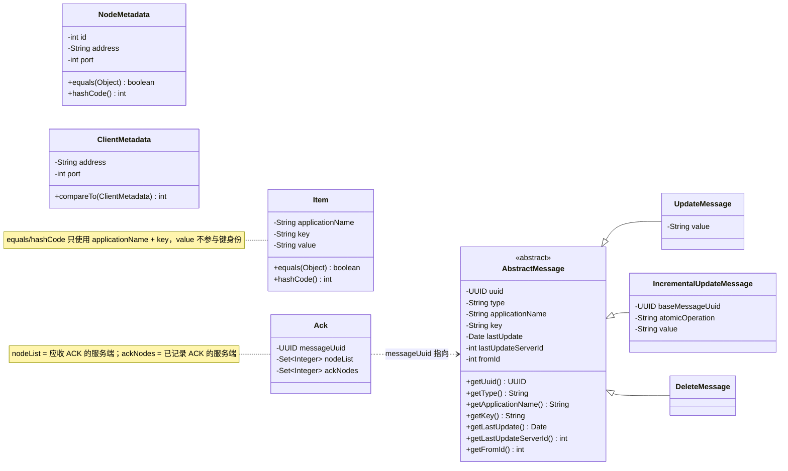
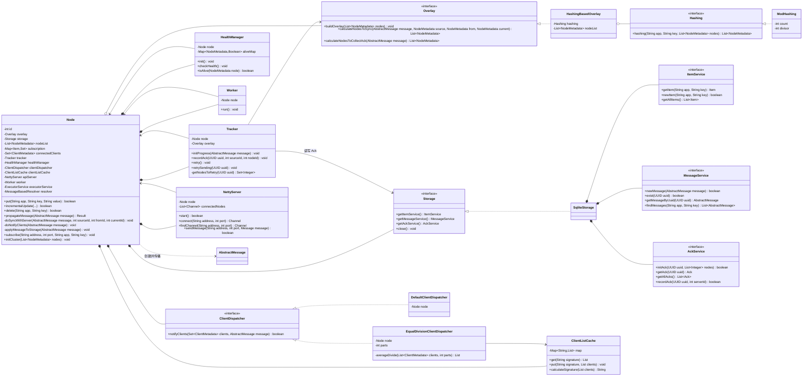
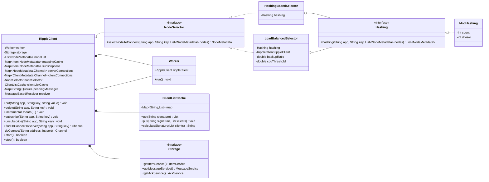
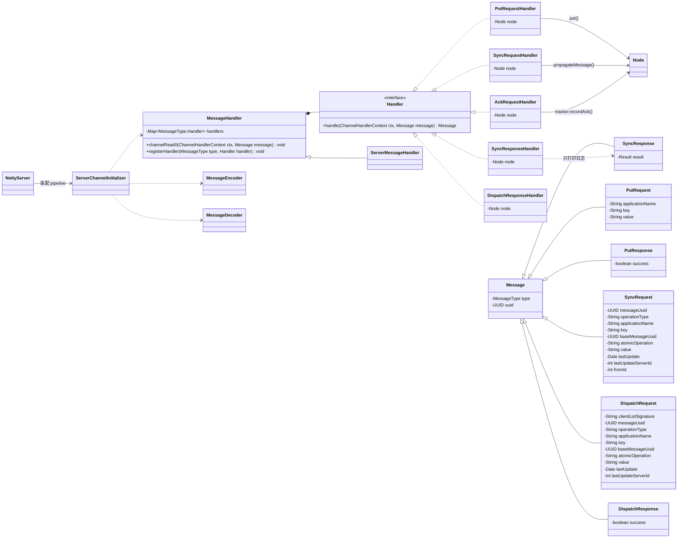
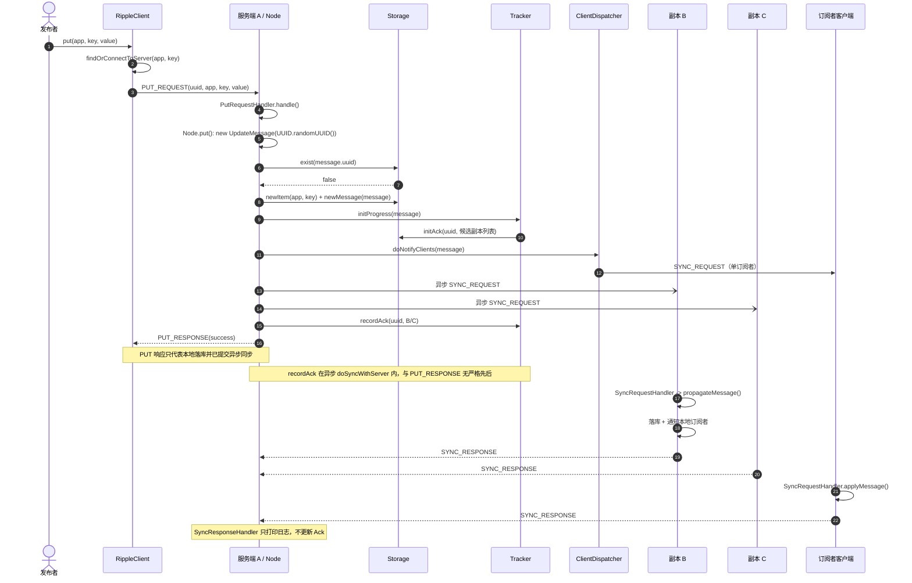

# Ripple 核心对象 UML

日期：2026-10-22  
源码：`Ripple/`，当前 HEAD `0469814`；带宽基准提交为 `468e9cb`（V0）。  
V1/V2 线格式开关见 `Ripple/documents/BandwidthOptimization.zh-cn.md`。

本文只画 **`put` 传播链路和带宽相关对象**，不包含 UI Servlet、全部编解码器和所有 Overlay 变体。图中的 Mermaid 代码可直接在 GitHub、支持 Mermaid 的 Markdown 预览器中渲染；如果编辑器不支持，可粘贴到 <https://mermaid.live> 查看。

关系符号：`<|--` 继承/实现，`*--` 组合，`o--` 聚合，`-->` 关联，`..>` 调用或依赖。

## 1. 领域消息与实体

要点：

- `UpdateMessage`、`IncrementalUpdateMessage`、`DeleteMessage` 是三种领域消息，`type` 分别是 `update`、`incremental_update`、`delete`。
- `lastUpdateServerId` 表示消息最初由哪个服务端产生；`fromId` 表示当前这一跳由谁发出。
- `Item` 是 `(applicationName, key)` 的索引对象；实际值由消息列表和 `MessageBasedResolver` 合并得到。

## 2. 服务端传播核心

要点：

- `Node` 是服务端传播的聚合根，组合了存储、Overlay、Tracker、健康检查、分发器和工作线程。
- `Node.subscription` 的实际类型是 `Map<Item, Set<ClientMetadata>>`，图中为排版简写为 `Map<Item, Set>`。
- `HashingBasedOverlay` 只在 **消息源节点** 返回其他候选副本；副本节点收到消息后返回空列表，因此不会继续扩散。
- `Tracker` 的 `initProgress` 只由消息源调用；`retry` 由 `Worker` 每 10 秒调用一次。
- `EqualDivisionClientDispatcher` 把订阅者按 `parts=3` 均分：单元素组直接发 `SYNC_REQUEST`；多元素组只把组首客户端作为入口发 `DISPATCH_REQUEST`，由它再向组内其余客户端转发。
- `SqliteStorage` 内部组合 `SqliteItemService`、`SqliteMessageService`、`SqliteAckService`；图中省略了这三个实现类。

## 3. 客户端与选服

要点：

- `RippleClient.findOrConnectToServer` 先用 `mappingCache` 缓存 `(app, key) -> 服务端`；未命中时调用 `NodeSelector`，再按需建立 Netty 连接。
- 默认的 `HashingBasedSelector` 先由 `ModHashing` 算出候选副本列表，再在候选中 **随机选 1 个** 作为本次发布入口。
- `LoadBalancedSelector` 会读取服务端 CPU 使用率，超过阈值时扩大候选范围。
- `RippleClient` 没有客户端侧 PUT 重试；连接断开由 `ClientMessageHandler.channelInactive` 清理，下一次 `put/subscribe` 再惰性重连。

## 4. 网络协议与处理器

要点：

- `PutRequest.uuid` 是 **请求关联 UUID**；`Node.put()` 会新建 `UpdateMessage`，其 `uuid` 是 **消息 UUID**，两者不是同一个值。
- `SyncRequest.uuid` 是本次同步请求的关联 UUID；`SyncRequest.messageUuid` 才是原消息的 UUID。
- `MessageHandler.channelRead0` 按 `MessageType` 找到 `Handler`；`Handler.handle` 返回非 `null` 时，Netty 自动写回响应。
- `SyncResponseHandler` 在服务端和客户端都只打印日志并返回 `null`；`SYNC_RESPONSE` 不参与业务逻辑，也不更新 ACK。
- `NettyServer` 的 pipeline 由 `ServerChannelInitializer` 装配：长度帧解码、长度帧编码、`MessageEncoder`、`MessageDecoder`、`ServerMessageHandler`。
- 当前 HEAD 的 V1/V2 开关只改线格式，不改上面的对象关系：`TypeHelper.isCompactWire()` 把 UUID 从 40 B 文本改为 16 B 二进制，并把同步操作类型压成 1 B；`PayloadCodec` 对 `SYNC_REQUEST`/`DISPATCH_REQUEST` 的 value 做自适应 Deflate。默认关闭；`PUT_REQUEST` 不压缩。

## 5. 一次 PUT 的对象协作时序

时序中的关键事实：

1. `PUT_RESPONSE` 在 `Node.put` 返回后发出；此时服务端间同步是异步任务，可能尚未完成。
2. `Tracker.initProgress` 在消息源初始化 ACK 目标；`doSyncWithServer` 在每次 `Api.sync` 写出后立刻 `recordAck`，并不等待对端真正处理完。
3. 哈希 Overlay 下，副本 B/C 的 `calculateNodesToSync` 返回空列表，所以它们只落库和通知本地订阅者，不会继续向其他副本扩散。
4. 单订阅者时服务端直接发 `SYNC_REQUEST`；多订阅者时按 `parts=3` 均分，组首客户端收 `DISPATCH_REQUEST` 并负责组内转发，单元素组直接收 `SYNC_REQUEST`。
5. `SYNC_RESPONSE` 在这条链路里只产生日志流量，可以作为后续协议裁剪对象。

## 6. 对象与线上字节的对应关系

以下为 `bandwidth_test` 在 1024 B、3 服务端、1 订阅者、不限速场景下的观测值；包含 TCP/IP 和抓包点开销，不是单纯的对象字段大小。

| 对象/环节 | 线上消息 | 约每消息帧字节 | 说明 |
| --- | --- | ---: | --- |
| 发布者 → 服务端 | `PUT_REQUEST` | 1,165 B | `uuid + app + key + value` |
| 服务端 → 副本 2 | `SYNC_REQUEST` | 1,231 B | 完整 value 再传一份 |
| 服务端 → 副本 3 | `SYNC_REQUEST` | 1,231 B | 完整 value 再传一份 |
| 服务端 → 订阅者 | `SYNC_REQUEST` | 1,231 B | 单订阅者路径 |
| 服务端 → 发布者 | `PUT_RESPONSE` | 46 B 级 | 只含成功标志 |
| 副本/订阅者 → 服务端 | `SYNC_RESPONSE` × 3 | 约 337 B 合计 | 只用于日志 |
| 其他 | 心跳、ACK、TCP 控制等 | 约 450 B | 随运行时间变化 |

结论：在当前 1024 B、3 副本场景中，主要带宽不是对象头，而是 **同一份 value 被完整发送了 4 次**（1 次 PUT + 2 次副本同步 + 1 次订阅下行）。因此对象级优化应优先减少复制份数或复制范围，其次才是压缩 `UUID`、字符串和响应消息。

## 7. 源码入口

- [Node.java](../Ripple/ripple-server/src/main/java/ripple/server/core/Node.java#L350-L420)
- [Node.java 的 doSyncWithServer](../Ripple/ripple-server/src/main/java/ripple/server/core/Node.java#L442-L473)
- [Tracker.java](../Ripple/ripple-server/src/main/java/ripple/server/core/Tracker.java)
- [HashingBasedOverlay.java](../Ripple/ripple-server/src/main/java/ripple/server/core/overlay/hashing/HashingBasedOverlay.java)
- [EqualDivisionClientDispatcher.java](../Ripple/ripple-server/src/main/java/ripple/server/core/dispatcher/EqualDivisionClientDispatcher.java)
- [RippleClient.java](../Ripple/ripple-client/src/main/java/ripple/client/RippleClient.java)
- [PutRequestHandler.java](../Ripple/ripple-server/src/main/java/ripple/server/tcp/handler/PutRequestHandler.java)
- [SyncRequestHandler.java](../Ripple/ripple-server/src/main/java/ripple/server/tcp/handler/SyncRequestHandler.java)
- [SyncResponseHandler.java](../Ripple/ripple-server/src/main/java/ripple/server/tcp/handler/SyncResponseHandler.java)
- [SyncRequestEncoder.java](../Ripple/ripple-common/src/main/java/ripple/common/tcp/encoder/SyncRequestEncoder.java)
